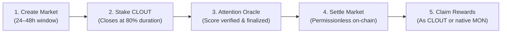

# CloutChase

> **Decentralized Attention Prediction Markets on Monad Testnet**

Trade the social attention economy before it peaks. CloutChase enables users to take on-chain **YES** or **NO** positions on whether creators, viral posts, or trending topics hit specified engagement targets within a 24–48 hour window. All markets are parimutuel, decentralized, settled by an attention oracle, and denominated with fixed valuation in native **MON** and **USD**.

---

## Table of Contents

- [Overview](#overview)
- [Key Features](#key-features)
- [How It Works](#how-it-works)
  - [Market Lifecycle](#market-lifecycle)
  - [Parimutuel Economics & Payouts](#parimutuel-economics--payouts)
  - [Valuation & Cashout Model](#valuation--cashout-model)
- [Smart Contracts (Monad Testnet)](#smart-contracts-monad-testnet)
- [Tech Stack](#tech-stack)
- [Prerequisites](#prerequisites)
- [Setup & Installation](#setup--installation)
- [Running the App](#running-the-app)
- [Smart Contract Development & Deployment](#smart-contract-development--deployment)
- [Network Configuration](#network-configuration)
- [License](#license)

---

## Overview

Social media virality moves faster than traditional financial markets. CloutChase turns viral attention into a liquid prediction market on [Monad Testnet](https://testnet.monadexplorer.com).

Users stake **`CLOUT`** tokens on market outcomes. Because markets use a **parimutuel pool**, odds dynamically adjust as traders stake on either side. When the market duration concludes, the **Attention Oracle** reports the finalized engagement score. Winners receive their principal back plus their pro-rata share of the opposing pool, which can be cashed out immediately to native **`MON`** directly into their connected wallet.

---

## Key Features

- **Parimutuel YES / NO Markets**: Dynamic crowd-priced odds with no liquidity provider impermanent loss.
- **Attention Oracle**: Dual-mode oracle supporting verified multi-reporter consensus with permissionless testnet fallback so settlements never stall.
- **Fixed Valuation Framework**:
  - `2,000 CLOUT = 1 MON = $3.00 USD`
  - `1 CLOUT = 0.0005 MON = $0.0015 USD`
  - Real-time conversion displayed across pools, odds rails, stake previews, portfolio, and leaderboard.
- **Direct MON Cashout Vault (`CloutCashout.sol`)**:
  - Exchange CLOUT tokens for native MON sent straight to your connected Web3 address.
  - **"Claim as MON"**: Win a market and collect your payout directly in native MON in a single transaction.
  - **Cashout Calculator Modal**: Quick presets (100, 500, 1000, 2000, Max) and live USD conversion.
- **Creator Incentives**: Market creators earn 1% of the losing pool on markets they create.
- **Built-in Testnet Faucet**: Claim 1,000 test CLOUT tokens once every 24 hours directly from the wallet dropdown.
- **Interactive 3D Visuals**: Real-time reactive WebGL hero visual built with Three.js and React Three Fiber.
- **Trader Portfolio & Leaderboard**: Track open bets, claim winnings, review historical win-rates, and inspect profit rankings.


## How It Works

### Market Lifecycle



1. **Market Creation**: Any user can launch a market for a post URL, creator handle, or trend tag with a target attention score (e.g. 250,000 engagements) and duration (24, 36, or 48 hours).
2. **Staking Period**: Users stake CLOUT on **YES** or **NO**. Staking closes automatically at 80% of the duration window to prevent front-running obvious outcomes.
3. **Oracle Finalization**: At window expiry, the attention oracle reports the measured engagement score.
4. **Settlement**: Anyone can trigger `settle(marketId)`. If `finalScore >= threshold`, **YES** wins; otherwise, **NO** wins.
5. **Payout Collection**: Winning stakers can claim their payout as `CLOUT` or swap it directly for native `MON` via the cashout vault.

---

### Parimutuel Economics & Payouts

In a parimutuel market, you bet against other participants rather than against a house or market maker:

$$\text{Winning Payout} = \text{User Stake} + \left( \frac{\text{Distributable Losing Pool} \times \text{User Stake}}{\text{Total Winning Pool}} \right)$$

Where:

- $\text{Distributable Losing Pool} = \text{Losing Pool} - \text{Protocol Fee (2\%)} - \text{Creator Fee (1\%)}$
- **Fee Protection**: Fees are deducted **only from the losing pool**. Winners keep 100% of their staked principal.
- **Canceled or One-Sided Markets**: If a market is canceled or has zero opposition, all stakers receive a **100% full refund with zero fees**.

---

### Valuation & Cashout Model

To bridge prediction tokens to real economic value, CloutChase implements a fixed conversion peg:

$$\mathbf{2{,}000\text{ CLOUT} = 1\text{ MON} = \$3.00\text{ USD}}$$

The **`CloutCashout`** contract maintains a native MON liquidity reserve. When users call `cashout(amount)` or choose **"Claim as MON"**, the contract burns or vaults the CLOUT tokens and transfers the corresponding native MON directly to `msg.sender`.

---

## Smart Contracts (Monad Testnet)

All contracts are deployed on **Monad Testnet (Chain ID: 10143)**:

| Contract                   | Address                                      | Explorer Link                                                                                            
| **`CloutToken` (`CLOUT`)** | `0x903f3BA0c170bFD5D280983c0bC1121C30CF71e4` | [View on Monad Explorer](https://testnet.monadexplorer.com/address/0x903f3BA0c170bFD5D280983c0bC1121C30CF71e4) |
| **`AttentionOracleV2`**    | `0x6dc4934d9299E3A039161cA851395f0c49F4E667` | [View on Monad Explorer](https://testnet.monadexplorer.com/address/0x6dc4934d9299E3A039161cA851395f0c49F4E667) |
| **`CloutChaseMarket`**     | `0xCfd50960286Cd5d0b2BaDcD75B85692e58961fc6` | [View on Monad Explorer](https://testnet.monadexplorer.com/address/0xCfd50960286Cd5d0b2BaDcD75B85692e58961fc6) |
| **`CloutCashout`**         | `0x209756F00029c0a8432bC12B823F278ec10735D3` | [View on Monad Explorer](https://testnet.monadexplorer.com/address/0x209756F00029c0a8432bC12B823F278ec10735D3) |

---

## Tech Stack

- **Frontend Core**: [React 19](https://react.dev/), [Vite](https://vitejs.dev/), [TypeScript](https://www.typescriptlang.org/)
- **Routing**: [TanStack Router](https://tanstack.com/router) (file-based typed routing)
- **State & Data Fetching**: [TanStack Query](https://tanstack.com/query)
- **Web3 Layer**: [Wagmi v3](https://wagmi.sh/), [Viem](https://viem.sh/)
- **Styling & UI**: [Tailwind CSS v4](https://tailwindcss.com/), Radix UI Primitives, [Sonner](https://sonner.emilkowal.ski/)
- **3D Graphics**: [Three.js](https://threejs.org/), [@react-three/fiber](https://docs.pmnd.rs/react-three-fiber), [@react-three/drei](https://github.com/pmndrs/drei)
- **Smart Contracts**: [Solidity 0.8.24](https://soliditylang.org/), [Foundry](https://book.getfoundry.sh/) (`forge`, `cast`)

---

## Prerequisites

Before setting up the project, make sure you have installed:

- **Node.js**: `v20.x` or higher
- **npm** (or `pnpm` / `bun`)
- **Web3 Wallet**: MetaMask, Rabby, Coinbase Wallet, or any wallet compatible with Monad Testnet
- **Foundry** _(Optional — only required if compiling or modifying smart contracts)_:
  ```bash
  curl -L https://foundry.paradigm.xyz | bash
  foundryup
  ```

---

## Setup & Installation

### 1. Clone the repository

```bash
git clone https://github.com/your-username/clout-chase-hub.git
cd clout-chase-hub
```

### 2. Install dependencies

```bash
npm install
```

### 3. Configure environment variables

Copy the example environment file:

```bash
cp .env.example .env
```

Your `.env` should include the Monad RPC URL and deployed contract addresses:

```env
VITE_MONAD_RPC_URL=https://testnet-rpc.monad.xyz
VITE_CLOUT_TOKEN_ADDRESS=0x903f3BA0c170bFD5D280983c0bC1121C30CF71e4
VITE_ORACLE_ADDRESS=0x6dc4934d9299E3A039161cA851395f0c49F4E667
VITE_MARKET_ADDRESS=0xCfd50960286Cd5d0b2BaDcD75B85692e58961fc6
VITE_CASHOUT_ADDRESS=0x209756F00029c0a8432bC12B823F278ec10735D3
```

> **Note**: If contract addresses are omitted, the app will automatically launch in an interactive, local simulation **Demo Mode** with mock markets and wallet states.

---

## Running the App

### Start development server

```bash
npm run dev
```

Open [http://localhost:5173](http://localhost:5173) in your browser.

### Build for production

```bash
npm run build
```

### Preview production build

```bash
npm run preview
```

### Code formatting and linting

```bash
npm run format   # Format with Prettier
npm run lint     # Check with ESLint
```

---

## Smart Contract Development & Deployment

The smart contracts are located in the `contracts/` directory and built with Foundry.

### 1. Build and test contracts

```bash
cd contracts
forge build
forge test -vvv
```

### 2. Configure deployment environment

Create `contracts/.env`:

```env
PRIVATE_KEY=your_private_key_here
MONAD_RPC_URL=https://testnet-rpc.monad.xyz
```

### 3. Deploy contracts to Monad Testnet

Run the automated deployment script which deploys the tokens, oracle, market, and funded cashout vault:

```bash
forge script script/Deploy.s.sol:Deploy --rpc-url $MONAD_RPC_URL --broadcast
```

After deployment, copy the output addresses (`VITE_*`) into the root `.env` file and rebuild the frontend.

---

## Network Configuration

To add Monad Testnet manually to your wallet:

 Property             Value                               
   
 **Network Name**     Monad Testnet                       
 **Chain ID**         `10143`                             
 **Currency Symbol**  `MON`                               
 **RPC URL**          `https://testnet-rpc.monad.xyz`     
 **Block Explorer**   `https://testnet.monadexplorer.com` 


## License

This project is licensed under the [MIT License](LICENSE).
